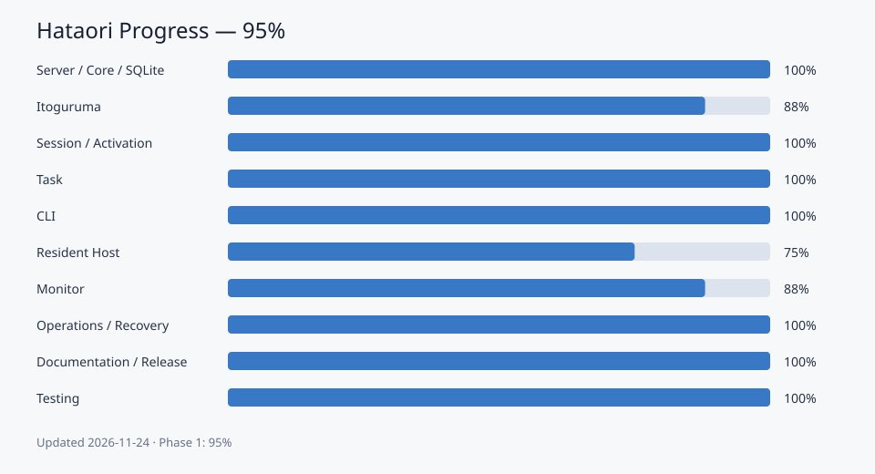

# PROGRESS.md Version
2026.11.26

# 変更履歴

- 2026.11.26: 3.2.5.0（トレイに全製品共通仕様の「MCPサーバー」サブメニューと4状態ランプ、状態確認・起動・停止を追加。Serverに`GET /health`を追加）。Releaseビルド警告0・エラー0、Solution Releaseテスト303件合格（1件スキップ）、ランプ4色とメニュー描画を画像で確認。ユーザー単位MSI `Hataori-3.2.5.0-user-x64.msi`（SHA-256 `6c51c512e588a5cefa9f8fa3ac642c849509ffc395de46d828cb8b69f7651e29`）を`E:\Hataori`へ上書きインストール（終了コード0、`config\hataori.json`のハッシュ不変）。Monitor起動でServerが起動し、`/health`が`ok`・3.2.5.0、`doctor` healthyを確認。トレイからの停止→起動の実機操作は未確認。Serverが19:55に終了ログなしで停止した事象を再観測（原因未調査）。進捗率は据え置き。
- 2026.11.26: 3.2.4.0（Monitorトレイメニューに「Serverを再起動」を追加、commit `045040e`）。Releaseビルド警告0・エラー0、Solution Releaseテスト266件合格（1件スキップ）。ユーザー単位MSI `Hataori-3.2.4.0-user-x64.msi`（SHA-256 `5a465bfb1f9062dd543085f9109f753d5b4087b61f49219d8f081bdb10cf4ed3`）を`E:\Hataori`へ上書きインストール（終了コード0、`config\hataori.json`のハッシュ不変）。Monitor起動でServerが起動し、`doctor` healthy、MCP `get_version`で3.2.4.0を確認。トレイからの再起動操作は未確認。進捗率は据え置き。
- 2026.11.25: 残作業を再確認。3.2.3.0は2026.11.24 22:23の起動から約13時間停止なく稼働しているが、MonitorのControl Pipe応答タイムアウトが05時台5件・11時台12件再発（Server側は応答遅延後の`Pipe is broken`）。残作業1をタイムアウト原因の調査・修正として更新。Moyai経由のGit操作が再び利用可能。進捗率は全体96%、Phase 1 98%で据え置き。
- 2026.11.25: Itoguruma 0.3.45で受信・ACKを実機確認。専用検証Project `hataori_lease_test` を`McpItogurumaClient`で登録し、送信→`get_messages`でリース（`lease_id`取得）→`ack_message`でACK成功→再取得で0件を確認（`ItogurumaLiveLeaseTests`、`HATAORI_ITOGURUMA_LIVE_TEST=1`のときだけ実行）。実機の`activation.enabled=false`は変更せず、他Projectの受信箱には触れていない。検証後に履歴・エージェント登録・Projectを削除。Itoguruma連携88%→100%、全体95%→96%、Phase 1 95%→98%。
- 2026.11.25: 3.2.3.0のMonitor・Serverが2026.11.24 22:23の起動から約6.5時間停止せず稼働し、その間MonitorのControl Pipe応答タイムアウト0件、Serverログの書き込みは22:26以降なし（警告によるログ増加の停止を確認）。残作業を6件で据え置き。進捗率は全体95%、Phase 1 95%で据え置き（更新周期内のため列は追加しない）。
- 2026.11.24: 3.2.3.0のユーザー単位MSIを`E:\Hataori`へ上書きインストール（終了コード0、設定ファイルのハッシュ不変）。起動後1分間のServerログで「not found in cache」警告0件、エラー・警告0件、Itoguruma 0.3.45への接続成功、`doctor` healthyを確認し、ログ警告の残作業を完了。なお22:03ごろMonitor・Serverが終了ログなしで停止しており（Server log 22:03:30で途絶）、17:46以降はMonitorにControl Pipe応答タイムアウトが散発。原因は未調査で残作業へ追加。進捗率は据え置き。
- 2026.11.24: Itoguruma接続時にMCPのツール一覧を一度取得し、`tools/call`のたびに出ていた「Tool '...' not found in cache」警告を止める修正を実装。Release build警告0・エラー0、Solution Releaseテスト263件合格。実機ログでの停止確認は次のMSI更新時に行う。進捗率は据え置き。
- 2026.11.24: 残作業を再整理。3.2.1.0・3.2.2.0の変更と記録を`develop`へpush済み（HEAD `9afa532`）のため完了扱いとし、残りを6件へ更新。進捗率は全体95%、Phase 1 95%で据え置き。
- 2026.11.24: 3.2.2.0のユーザー単位MSIを`E:\Hataori`へ上書きインストール（終了コード0、設定ファイルのハッシュ不変）。ログオン時と同じ`--startup`でMonitorを起動し、ServerがMonitorから起動、`doctor` healthy、Itoguruma 0.3.44への接続成功を確認。3.2.1.0では当日`register_agent`の失敗が15,819回記録されていたが、3.2.2.0では接続エラーなし。実機設定は`activation.enabled=false`のため、メッセージの受信・ACKは実行されず未確認。通知領域に新しい機織り機アイコンが表示されることを利用者が目視で確認。
- 2026.11.24: Itoguruma 0.3.44の登録・リースAPIへ対応（3.2.2.0）。Project Inboxは未登録時だけ`register_project_inbox`で登録し、既存の表示名を保持。無効化ProjectとProject ID規則外のディレクトリは受信対象外。`get_messages`へ受信者IDを渡し、返された`lease_id`で`ack_message`。Hataori自身は`itoguruma.projectId`（既定`hataori`）のInboxを送信元・受信者として使う。Release build警告0・エラー0、Solution Releaseテスト263件合格。Itogurumaは88%（実機受信・ACKは未確認）、全体95%、Phase 1 95%。
- 2026.11.24: 機織り機（正面図）のアプリアイコンをMonitorのexe・ウィンドウ・トレイとMSIの`ARPPRODUCTICON`へ組み込み、commit `b1f220c`として`develop`へ選択commit（未push）。Monitorテスト41件合格、Debugビルド警告0・エラー0、MSIのIcon表登録を確認。HataoriをMoyai／Githubieへ登録。2026.11.24列を追加し、ユーザー単位版3.2.1.0とItoguruma 0.3.44のAPI変更を反映して再採点。同日、Release build警告0・エラー0、Solution Releaseテスト253件（Core 17、Infrastructure 49、CLI 54、Server 92、Monitor 41）全件合格を確認し、テストを100%へ戻した（全体99%→90%、Phase 1 98%→85%）。
- 2026.11.23: Hataori 3.2.1.0をユーザー単位MSIで `E:\Hataori` に導入。旧Windowsサービスを削除し、設定・SQLiteの検証済みバックアップを保持。ログオン起動コマンドの登録と実行、Monitor／Serverの同一ユーザー・同一セッションでの起動、同ユーザーからの制御パイプ、MCP 28ツール、SQLite整合性を確認。Releaseテスト245件、WiXビルド警告0・エラー0。実ログオンと通知領域のアイコン表示・復帰は未確認。Itoguruma 0.3.44への認証は成功するが、メッセージ連携は新しい登録・リースAPIへの対応が必要。

- 2026.11.22: GithubieがHataoriの登録パスをE:\Workspace\Projects\Hataoriへ変更（CR完了）。3.1.23.0の変更をcommit `1308baf`としてGithubie経由で`develop`へpush（`a85af49`を含む）。`**/TestResults/`を.gitignoreへ追加。E:\Hataoriへの移行と実機更新はCodexタスクが進行中。進捗率は据え置き。
- 2026.11.22: Githubie登録パス修正のCR `CR-2026-11-22-hataori-local-root-reparse-point.md`を起票しItogurumaで送信（message ID `3cabdb84ce9843ec88c84a374010203e`）。C:\Hataoriでの実機更新タスクは取消され、E:\Hataoriへの移行と3.1.23.0実機更新はCodexタスク`hataori-live-migration-e-31230-20261122`が担当。進捗率は据え置き。
- 2026.11.22: 3.1.23.0（Monitorトレイ常駐・起動時自動MSI更新・設定画面）をClaude Codeが引き継ぎ検証。Release build警告0・エラー0、Solution Releaseテスト245件（Core 17、Infrastructure 49、CLI 54、Server 92、Monitor 33）合格、WiX MSI `Hataori-3.1.23.0-x64.msi`（SHA-256 `8e6b3123a88e9853ea8854f62a4be2c95abad7df36efafaff0b59f8e871bffde`）生成。更新先設定は実行ファイルへ埋め込み済み。実機Major Upgrade・UAC取消・サービス復帰・更新後再起動は未確認。Githubieが旧登録パスの再解析ポイントを拒否するためcommit・pushは未実施。進捗率は据え置き。
- 2026.11.03: Monitor実機確認の事前読取でHataori ServiceがRunning／Automatic、標準配置のMonitor実行ファイルが存在することを確認。GUI表示・更新・キャンセル操作は未実施で、AGENTS.mdのComputerUse規則に基づく明示許可待ち。実行手順とテスト専用データの条件を`docs/validation/2026-11-03-monitor-live-acceptance.md`に記録。進捗率は据え置き。
- 2026.11.03: Monitor回帰テスト追加後のSolution Releaseテストを完了。Core 17、Infrastructure 49、CLI 54、Server 92、Monitor 5件の計217件が合格。テストカテゴリを88%から100%へ再評価し、全体は98.8%→99%、Phase 1は97.6%→98%。検証記録は`docs/validation/2026-11-03-release-test-attempt.md`。
- 2026.11.03: Monitor回帰テスト追加後のReleaseテストをプロジェクト別に実行。Core 17、Infrastructure 49、Server 92、Monitor 5、CLI 52が合格。CLIの名前付きパイプを使う2件はsandbox内でハングし未確認。全Solution外部実行はworkspace credits不足で自動承認審査が開始できず、集計完了には至らない。記録は`docs/validation/2026-11-03-release-test-attempt.md`。受入軸は据え置き、全体98%・Phase 1 98%。
- 2026.11.01: 実装・自動テスト・受入確認・文書の4軸（各25点）の算定基準を定義し、現行証跡で10カテゴリを再評価。Monitorとテストは受入確認が部分証拠のため各88%、他8カテゴリは100%。全体97.6%→98%、Phase 1 97.6%→98%。P2の算定基準・再計算を完了。
- 2026.11.01: Monitor専用のWindows STA WinFormsテスト5件を追加。Snapshot表示・データ更新、Task／Agent Run状態によるキャンセル可否、確認・拒否・失敗応答の操作を自動検証し、Windows環境で5/5件合格。検証記録は`docs/validation/2026-11-01-monitor-regression.md`。この時点では進捗率算定基準の整理を次作業として残した。
- 2026.11.01: 進捗率の根拠を仕様・テスト・受入記録と照合。Itogurumaは実機でBearer接続、受信後永続化・ACK、Replyと同一idempotency key再送を検証し、Worker／structured-contentの自動テストもある。CLIは各コマンド群の自動テストと実機検証がある。これらに具体的な未完了機能は見つからない一方、MonitorはADR 0010がWinForms表示を含む自動テストを検証対象としているが、専用test projectがなく、後続の実機記録もInstall／Version確認中心。Monitor回帰テストと機能別進捗の算定基準定義をTODOのP2に登録。既存率の元の配点根拠は残っていないため数値を推測で変えず、全体99%・Phase 1 99%およびグラフは据え置き。
- 2026.10.01: Claude Code 2.1.233で`KotodamaSpecGuard`をセッション限定で読み込み、仕様書MarkdownへのWrite後のPostToolUse hook発火、`layer-reviewer`起動、実装混入0件・要確認0件を実機確認。検証用ファイルは削除し、永続設定・既存プロジェクトファイルは変更なし。
- 2026.10.01: `KotodamaSpecGuard`の公開・Hataori側診断実装が完了済みで、残作業はClaude Code実行時のhook発火から`layer-reviewer`起動までの実機確認1件であることを再確認。機能進捗率に変更はなく、更新周期内のため進捗表・グラフは据え置き。
- 2026.09.30: `KotodamaSpecGuard` 0.1.0のprivate GitHub Repositoryへのcommit・push完了を反映。残作業をClaude Code実機hook検証の1件へ整理。
- 2026.09.27: 3.1.22.0をGitHub Releaseとして公開。`develop`から`main`へのPR #18をマージし、`v3.1.22.0`とx64 MSIを公開。残作業を外部プラグインのGitHub公開・Claude Code実機hook検証の2件へ整理。
- 2026.09.26: 3.1.22.0をRelease対象として検証。`doctor`のClaude Codeプラグイン有効化診断、Release build、212テスト、WiX MSI、`C:\Hataori`実機Major Upgrade、Service・CLI・MCP・DB整合性を確認。
- 2026.09.25: `doctor`へ読み取り専用の`claude_plugins`診断を追加。対象プラグインIDとClaude Code設定pathを構成可能にし、Releaseテスト212件と文書リンク65件を検証。
- 2026.09.24: `kotodama-spec-guard` 0.1.0の本体を別リポジトリへ実装した状況を残作業へ反映。
- 2026.09.04: 3.1.21.0の完了範囲と、契約／実装レイヤー混同防止プラグインの将来対応を区別し、TODO.mdと残作業の記載を整合。
- 2026.09.02: VirtualBox Windows 11隔離環境で3.1.21.0の新規Install／Uninstallを検証。製品登録・Service・`bin`・System `Path`削除と`config`・`data`・`logs`保持を確認。
- 2026.09.02: 3.1.21.0をRelease。文書リンク自動検証、64文書、207テスト、MSI、実機`C:\Hataori`稼働を検証。
- 2026.09.02: 3.1.21.0へVersion更新。文書リンク自動検証をMSI化し、64文書、207テスト、`C:\Hataori`実機Major Upgrade、CLI・Service・MCP・DB整合性を検証。
- 2026.09.02: Git管理中Markdownの相対リンク切れとRepository外参照を検出するPowerShell検証とGitHub Actionsを追加。
- 2026.09.02: 3.1.20.0をRelease。`doctor`のService Account差異テスト、207テスト、MSI、実機`C:\Hataori`稼働を検証。
- 2026.09.02: 3.1.20.0へVersion更新。`doctor`のService Account差異テストをMSI化し、207テスト、`C:\Hataori`実機Major Upgrade、CLI・Service・MCP・DB整合性を検証。
- 2026.09.02: `doctor`のService Account差異分岐を内部Runnerへ抽出し、アクセス拒否のSkipped化、通常障害、キャンセル伝播の専用自動テストを追加。
- 2026.09.02: Claude CLIアクセス拒否はCodex sandbox SIDによる診断環境差と確定。実ユーザーではClaude Code 2.1.220起動成功、`doctor` healthyを確認し、未解決項目から除外。
- 2026.09.02: 3.1.19.0時点の実態へ進捗率、Phase 1、グラフ、完了機能、残作業を同期。全体99%、Phase 1 99%。
- 2026.09.02: 3.1.19.0へVersion更新。詳細MetricsをMSI化し、204テスト、`C:\Hataori`実機Major Upgrade、CLI・Service・MCP・DB整合性を検証。
- 2026.09.02: Workspace単位の詳細Metricsを実装。Task／Message／Agent Runの状態件数、成功率、再試行、平均時間、Agent別内訳をCLI／MCPへ追加し、204テストを検証。
- 2026.09.02: 3.1.18.0へVersion更新。203テスト、WiX MSI、`C:\Hataori`実機Major Upgrade、Service・MCP・Agent定義・DB整合性を検証。
- 2026.09.01: 3.1.17.0へVersion更新。Agent定義SQLite永続化をMSI化し、203テスト、`C:\Hataori`実機Major Upgrade、Service・MCP・DB整合性を検証。

- 2026.09.01: 3.1.16.0をRelease。Monitor管理操作、200テスト、MSI、実機`C:\Hataori`稼働を検証。
- 2026.09.01: 3.1.16.0実機環境を`C:\Hataori`へ統一し、Service・Registry・設定・DB・ログ移設を検証。
- 2026.09.01: Monitor管理操作を3.1.16.0へ反映し、200テスト、MSI build、実機Major Upgradeを検証。
- 2026.09.01: 3.1.15.0をRelease。複数Activation root対応をMSI化し、198テスト、実機Major Upgrade、2 root MCP列挙を検証。
- 2026.09.01: 3.1.14.0をRelease。Workspace管理v2をMSI化し、193テスト、実機Major Upgrade、Service・MCP・doctorを検証。
- 2026.09.01: 複数Activation root設定とWorkspace別Itoguruma取り込みを実装し、198テストを検証。
- 2026.09.01: MonitorへTask／Agent Runキャンセル操作を追加し、200テストを検証。
- 2026.09.01: Agent定義をWorkspace単位のSQLiteへ永続化。初回設定移行、CLI／MCP管理、監査履歴、DB定義に基づくActivation laneを実装し、203テストを検証。
- 2026.08.31: Workspace管理v2を実装。Session・Message・Agent RunへWorkspace IDを伝播し、既存SQLite移行、Monitor表示、CLI filter、193テストを検証。
- 2026.08.31: 3.1.13.0をRelease。Workspace単位のTask管理、`list_workspaces`、SQLite移行、Monitor・会話Hook連携を実装し、189テストと実機Major Upgradeを検証。
- 2026.08.31: 3.1.12.0をRelease。MCP `list_projects`、未登録Project候補返却、Task登録前Project選択案内を実装し、179テストと実機Major Upgradeを検証。
- 2026.08.26: 3.1.9.0をRelease。MCP Server Instructionsと`hataori_workflow` Promptを追加し、実機Major UpgradeとMCP配信を検証。
- 2026.08.25: 3.1.8.0をRelease。MCP outputSchema契約修正とActivation既定値のBind時重複修正（新規Install起動クラッシュの原因）を反映。
- 2026.08.18
- 2026.08.16

# Hataori 進捗率履歴

この文書は、Hataoriの機能別進捗率、完了内容、残作業の正本です。

## グラフ

## 運用ルール

- 原則3日周期で日付列を追加します。
- 各機能は、実装・自動テスト・実環境確認・利用者文書の充足度から算定します。
- プロジェクト全体は、下表10機能の単純平均を整数四捨五入します。
- Phase 1は、仕様書のCore、Itoguruma、Session / Activation、Task、Monitorの単純平均です。

### 進捗率算定基準（2026.11.01）

各カテゴリを4つの証拠軸で評価し、各軸を同じ25点として扱います。対象範囲はリポジトリの仕様・TODO・機能チェックリストに記載された主要機能です。要求のない品質特性や未記録の将来構想は採点に加えません。

| 証拠軸 | 100点 | 50点 | 0点 |
| :--- | :--- | :--- | :--- |
| 実装・範囲 | 対象カテゴリの主要項目が実装済みで、未完了の主要TODOがない。 | 主要経路はあるが、主要項目が一部未実装。 | 主要機能が未実装、または実装証拠がない。 |
| 自動テスト | 主要な正常系・失敗系を含むテストがあり、対象動作を追跡できる。 | テストはあるが、主要動作または失敗系に未確認部分がある。 | テストがない、または結果を確認できない。 |
| 受入確認 | 主要な実行・運用シナリオの合格証跡がある。 | 一部シナリオのみ、またはテストダブルによる確認に限られる。 | 合格証跡がない、または失敗が未解決。 |
| 利用・運用文書 | 利用者向けまたは運用者向けの必要な手順・制約が文書化されている。 | 文書はあるが、主要手順または制約が不足している。 | 必要な文書がない、または内容を確認できない。 |

カテゴリ率は4軸の平均を整数四捨五入します。総合率は10カテゴリ、Phase 1はCore／Itoguruma／Session・Activation／Task／Monitorの5カテゴリの平均を整数四捨五入します。未確認は完了扱いにせず、受入確認を部分証拠として採点します。

テストカテゴリのみ、実装・範囲軸を「各主要レイヤーのテストプロジェクトがSolutionに登録されている」、自動テスト軸を「主要経路に対応するテストがある」、受入確認軸を「最新のテスト追加後に全テストを一括実行している」、文書軸を「再実行コマンドと結果を記録している」と読み替えます。

## 履歴

### ≪Hataori≫

| 機能 | 2026.08.16 | 2026.08.18 | 2026.08.25 | 2026.08.26 | 2026.08.31 | 2026.09.02 | 2026.09.27 | 2026.09.30 | 2026.11.01 | 2026.11.03 | 2026.11.24 |
| :--- | ---: | ---: | ---: | ---: | ---: | ---: | ---: | ---: | ---: | ---: | ---: |
| **グループ全体** | **94%** | **96%** | **96%** | **96%** | **97%** | **99%** | **99%** | **99%** | **98%** | **99%** | **96%** |
| Server / Core / SQLite | 88% | 88% | 88% | 88% | 88% | 100% | 100% | 100% | 100% | 100% | 100% |
| Itoguruma連携 | 98% | 98% | 98% | 98% | 98% | 98% | 98% | 98% | 100% | 100% | 100% |
| Session / Activation | 100% | 100% | 100% | 100% | 100% | 100% | 100% | 100% | 100% | 100% | 100% |
| Task管理 | 95% | 95% | 95% | 95% | 97% | 100% | 100% | 100% | 100% | 100% | 100% |
| CLI | 97% | 98% | 98% | 98% | 98% | 99% | 99% | 99% | 100% | 100% | 100% |
| 常駐ホスト（旧Windows Service） | 100% | 100% | 100% | 100% | 100% | 100% | 100% | 100% | 100% | 100% | 75% |
| Monitor | 95% | 95% | 95% | 95% | 96% | 98% | 98% | 98% | 88% | 88% | 88% |
| 運用・復旧 | 97% | 99% | 100% | 100% | 100% | 100% | 100% | 100% | 100% | 100% | 100% |
| 文書・配布 | 75% | 90% | 90% | 90% | 95% | 100% | 100% | 100% | 100% | 100% | 100% |
| テスト | 96% | 96% | 97% | 97% | 99% | 99% | 99% | 99% | 88% | 100% | 100% |

2026.11.01以降の列は本基準で算定した値です。それより前の列は当時の算定方法が残っていないため、記録値として維持しており、新基準の値との直接比較には使いません。「常駐ホスト」行は、2026.11.03列まではWindows Service、2026.11.24列からはADR 0024のユーザー単位常駐（Monitorがログオン時に起動し、同じユーザーでServerを起動する方式）を評価しています。

### 2026.11.24列の証拠別採点

2026.11.03列から根拠が変わった4カテゴリだけを再採点し、他の6カテゴリは2026.11.03列の得点を据え置いています。

| カテゴリ | I | T | A | D | 得点 | 確認した主な証拠 |
| :--- | ---: | ---: | ---: | ---: | ---: | :--- |
| Itoguruma連携 | 100 | 100 | 100 | 100 | 100% | 3.2.2.0で登録・リースAPIへ対応（`McpItogurumaClient`、`ItogurumaConnectionWorker`）。`ItogurumaConnectionWorkerTests`でInbox登録・表示名保持・無効Project除外・lease IDでのACK・lease ID欠落時の拒否を検証。`CONFIG.md`に`projectId`と受信者IDを記載。`E:\Hataori`でItoguruma 0.3.45への接続を確認し、2026.11.25に専用検証Projectで送信・リース・ACK・ACK後0件を実機確認（`ItogurumaLiveLeaseTests`） |
| 常駐ホスト（旧Windows Service） | 100 | 50 | 50 | 100 | 75% | `UserServerProcess`とログオン起動登録を実装済み。2026.11.23に`E:\Hataori`で同一ユーザー・同一セッション起動を確認。ServerをMonitorから起動・停止する処理の自動テストはなく、実際のログオンからの起動は未確認。手順は`docs/installation.md` |
| Monitor | 100 | 100 | 50 | 100 | 88% | トレイ常駐・自動MSI更新・設定画面・アプリアイコンを実装し、Monitorテスト41件合格。3.2.2.0で通知領域の新しいアイコン表示を目視確認済み。トレイからの復帰、実サービス接続での更新・キャンセル操作、更新MSIによる自動更新は未確認 |
| テスト | 100 | 100 | 100 | 100 | 100% | アイコンテスト8件の追加後、2026.11.24にSolution Releaseテスト253件（Core 17、Infrastructure 49、CLI 54、Server 92、Monitor 41）を一括実行し全件合格 |

### 2026.11.03列の証拠別採点

I=実装・範囲、T=自動テスト、A=受入確認、D=利用・運用文書です。各値は前掲基準の0／50／100点で、4軸の平均を四捨五入しています。

| カテゴリ | I | T | A | D | 得点 | 確認した主な証拠 |
| :--- | ---: | ---: | ---: | ---: | ---: | :--- |
| Server / Core / SQLite | 100 | 100 | 100 | 100 | 100% | `tests/Hataori.Core.Tests`、`tests/Hataori.Server.Tests`、3.1.22.0のbuild・test・SQLite integrity記録 |
| Itoguruma連携 | 100 | 100 | 100 | 100 | 100% | `ItogurumaConnectionWorkerTests`、`ItogurumaStructuredContentDeserializerTests`、`2026-08-16-real-machine.md`のBearer受信・永続化ACK・Reply冪等再送 |
| Session / Activation | 100 | 100 | 100 | 100 | 100% | `ConversationSessionTests`、`ActivationManagerTests`、`2026-08-16-real-machine.md`の同一Session resume |
| Task管理 | 100 | 100 | 100 | 100 | 100% | `HataoriTaskTests`、`TaskMcpToolsTests`、Workspace／Task関連Release検証記録 |
| CLI | 100 | 100 | 100 | 100 | 100% | `tests/Hataori.Cli.Tests`、`2026-09-26-installer-3.1.22.0.md`、`COMMANDS.md` |
| Windows Service | 100 | 100 | 100 | 100 | 100% | `WindowsServiceManagerTests`、`WindowsServiceSetupServiceTests`、3.1.21.0／3.1.22.0のService・MSI検証、Installation文書 |
| Monitor | 100 | 100 | 50 | 100 | 88% | `Hataori.Monitor.Tests` 5件合格と`DrawToBitmap`。Service Running／AutomaticとMonitor実行ファイル配置は事前確認済み。画面上の更新・キャンセル受入は未記録 |
| 運用・復旧 | 100 | 100 | 100 | 100 | 100% | `StartupRecoveryServiceTests`、Reply Retryテスト、3.0.4.0のService復旧・`2026-08-16-real-machine.md`のGraceful Shutdown |
| 文書・配布 | 100 | 100 | 100 | 100 | 100% | 利用者文書・Release手順、Documentation Links workflow、3.1.21.0隔離Install／Uninstall、3.1.22.0 MSI検証 |
| テスト | 100 | 100 | 100 | 100 | 100% | Core 17、Infrastructure 49、CLI 54、Server 92、Monitor 5件、計217件がReleaseで合格。詳細は`docs/validation/2026-11-03-release-test-attempt.md` |

受入確認50点は未完了機能の断定ではなく、指定した証跡粒度を満たしていないことを示します。Monitorは実サービス接続での操作が未確認のため88%です。全Solution Releaseテストは217件がすべて合格したため、テストカテゴリは100%です。

## 現在フェーズ

Phase 1（基盤・必須運用機能）: **98%**

算定: Core 100%、Itoguruma 100%、Session / Activation 100%、Task 100%、Monitor 88%の単純平均（97.6%）を四捨五入しています。全体96%は10カテゴリ合計963%の平均96.3%を四捨五入した値です。

## 現在の完了状態と残作業

2026.11.24: 機織り機の正面図を描いたアプリアイコン（`assets/icon`）をMonitorのexe・ウィンドウ・トレイとMSIの「アプリ」一覧表示へ組み込み、通知領域での表示を目視確認しました。ユーザー単位版3.2.1.0の変更（`f780acf`）と、Itoguruma 0.3.44の登録・リースAPI対応（3.2.2.0、`5be9a29`）をcommitし、`develop`へpush済みです。2026.11.25時点で`E:\Hataori`は3.2.3.0で稼働し、`doctor` healthy、Itoguruma 0.3.45への接続と受信・ACKを確認済みです。HataoriはMoyaiとGithubieへ登録済みで、2026.11.25からMoyai経由のGit操作が再び使えています（2026.11.24はGithubie 2.2.2.0更新後の固定ハッシュ値不一致のためGithubie経由）。残作業は優先順に次のとおりです。

1. MonitorのControl Pipe応答タイムアウト（`Hataori Server did not respond before the timeout`）の原因を調べて直す。3.2.3.0でも2026.11.25 05時台に5件、11時台に12件再発し継続中。Server側ではMonitorがタイムアウトした後に応答を書こうとして`Pipe is broken`となっており、Serverは停止ではなく応答遅延。2026.11.24 22:03ごろMonitorとServerが終了ログなしで停止した件も合わせて調べる（3.2.3.0では停止は再発していない）。
2. トレイからの画面復帰と、実際のログオンからのMonitor・Server自動起動を確認する（通知領域のアイコン表示は確認済み）。
3. ServerをMonitorから起動・停止する処理（`UserServerProcess`）の自動テストを追加する。
4. 起動中のServerへMonitorを接続し、表示・更新とテスト専用Task／Agent Runのキャンセルを確認して記録する（手順: `docs/validation/2026-11-03-monitor-live-acceptance.md`）。
5. 更新MSIによるMonitorの自動更新と、更新後のMonitor再起動を実機で確認する。

Itoguruma 0.3.45での受信・ACKは2026.11.25に専用検証Projectで実機確認済みです（`ItogurumaLiveLeaseTests`）。

2026.11.24のSolution Releaseテストは263件すべて合格しました。

2026.11.23: 現在の実機はユーザー版3.2.1.0です。Windowsサービスを削除し、`E:\Hataori` の同一ユーザーでMonitorとServerが稼働しています。通知領域のアイコンとログオン後の実画面確認が残っています。Itogurumaへの認証は成功し、メッセージの登録・受信・ACKは0.3.44のAPIへの対応が必要です。

2026.11.22: 3.1.23.0向けにMonitorのタスクトレイ常駐、起動時の自動MSI更新、設定画面を実装しました。設定はユーザー単位の別ファイルへ原子的に保存し、Server設定は変更しません。Releaseビルドは警告0・エラー0、Solution Releaseテスト245件（Monitor 33件を含む）が全件合格し、WiX MSI `Hataori-3.1.23.0-x64.msi`を生成しました。更新MSIの配布元・サイズ・SHA-256、更新用プロセスへの引き継ぎ、単一起動、既存インストール先の保持を実装しています。UAC取消、実際のMajor Upgrade、サービス復帰、更新後のMonitor再起動は未確認です。Githubieが登録パス内の再解析ポイントを拒否したため、commit・pushは未実施です。登録パスは2026.11.22にGithubieがE:\Workspace\Projects\Hataoriへ変更し、3.1.23.0の変更はcommit `1308baf`として`develop`へpush済みです。実機更新（E:\Hataoriへの移行を含む）はCodexが担当しています。以前の進捗率は過去の評価として保持し、新機能の受入完了率には使いません。

2026.11.03時点で、全体99%・Phase 1 98%です。全体はカテゴリ合計988%の平均98.8%、Phase 1は対象5カテゴリ合計488%の平均97.6%を四捨五入しています。Monitorのみ88%で、実サービス接続での画面更新・Task／Agent Runキャンセルが未確認です。他9カテゴリは100%です。Solution Releaseテスト217件（Core 17、Infrastructure 49、CLI 54、Server 92、Monitor 5）は全件合格しました。事前確認ではHataori ServiceがRunning／Automatic、Monitor実行ファイルが標準配置にあることを確認しました。実画面操作および一時テストTask／Agent Runの作成・キャンセルはAGENTS.mdのComputerUse明示許可後に行います。手順と安全条件は`docs/validation/2026-11-03-monitor-live-acceptance.md`に記録しました。旧評価列は当時の根拠がないため変更していません。

3.1.22.0で`doctor`のClaude Codeプラグイン有効化診断を追加しました。Release構成build警告0件・エラー0件、自動テスト212件合格、WiX MSI build成功、`C:\Hataori`へのMajor Upgrade成功、Windows Service Running / Automatic、MCP 28 tools、SQLite integrity `ok`を確認しました。PR #18で`develop`を`main`へ反映し、`v3.1.22.0`のGitHub Releaseとx64 MSIを公開済みです。

3.1.22.0の実機検証では、既存設定を保持したMajor Upgrade後にCLI 3.1.22.0、Service稼働、MCP接続、`doctor` healthyを確認しました。既存設定には新しい`requiredClaudePlugin`がないため、後方互換動作として`claude_plugins`診断は無効です。新規生成設定では`kotodama-spec-guard@katsushoe-private`を診断します。新規Install／Uninstallは3.1.21.0で検証済みのため今回は実施していません。

契約（What）／実装（How）の混同防止プラグイン`kotodama-spec-guard`は、2026.09.24に0.1.0を別リポジトリ`KotodamaSpecGuard`へ実装し、2026.09.28にcommit `0937896`をprivate GitHub Repositoryへpushしました（Nodeテスト6件合格、マニフェスト・hook・agent・skill定義確認済み）。2026.09.25にHataoriの`doctor`へ読み取り専用の`claude_plugins`診断を実装しました。2026.10.01、Claude Code 2.1.233のセッション限定pluginとして検証し、仕様書MarkdownへのWrite後にPostToolUse hookが発火し、`layer-reviewer`が起動して実装混入0件・要確認0件と判定することを確認しました。検証用ファイルは削除し、永続plugin設定や既存プロジェクトファイルは変更していません。プラグイン実装・配布・Hataori有効化診断・実機hook確認は完了です。Hataoriは対象プロジェクトでのプラグイン有効化確認に限定し、対象ディレクトリへの設定自動書き込みは行いません。既存機能の進捗率と過去の検証結果は変更しません。

## 時系列の進捗・検証メモ

以下は各時点の履歴です。「未導入」「未実施」等は記載時点の状態であり、現在状態は直前の「現在の完了状態と残作業」を正本とします。

2026.09.01にMonitor管理操作を実装しました。Task一覧とAgent Run一覧でキャンセル可能な状態だけ操作を有効化し、確認後にControl Pipe経由でServerの既存ユースケースを実行します。操作後はスナップショットを再取得します。Release構成buildは警告0件・エラー0件、自動テスト200件が合格しました。

2026.09.01に複数Activation root対応を3.1.15.0としてリリースしました。Release構成buildは警告0件・エラー0件、自動テスト198件合格、WiX MSI buildは警告0件・エラー0件でした。3.1.14.0から`F:\Hataori`への実機Major Upgradeは終了コード0で成功しました。一時的な`default`・`validation`の2 root設定で`list_workspaces`が両Workspaceと各Projectを返し、`list_projects`が第2 rootの`labproject`を返すことを確認後、設定とServiceを元の正常状態へ復元しました。検証記録は`docs/validation/2026-09-01-installer-3.1.15.0.md`です。

2026.09.01に`activation.workspaces`による複数Projects root構成を実装しました。従来の`workspaceId`／`workingDirectory`は単一root設定として後方互換を維持します。Workspace ID、root path、Project IDの重複を起動時に拒否し、Itoguruma受信Messageへrootに対応するWorkspace IDを保存します。Release構成buildは警告0件・エラー0件、自動テスト198件が合格しました。

2026.09.01にWorkspace管理v2を3.1.14.0としてリリースしました。Release構成buildは警告0件・エラー0件、自動テスト193件合格、WiX MSI buildは警告0件・エラー0件でした。3.1.13.0から`F:\Hataori`への実機Major Upgradeは終了コード0で成功し、CLI 3.1.14.0、Windows Service Running / Automatic、MCP接続24ツール、`doctor` healthyを確認しました。検証記録は`docs/validation/2026-09-01-installer-3.1.14.0.md`です。

2026.08.31に3.1.13.0をリリースしました。Workspace ID、Workspace単位のTask登録・一覧・競合検索、MCP `list_workspaces`、既存SQLite Taskの`default` Workspace移行、Monitor Task・会話Hook連携を追加しました。Release構成buildは警告0件・エラー0件、自動テスト189件合格、MSI buildと実機Major Upgradeは成功し、CLI 3.1.13.0、Windows Service Running / Automatic、MCP 24ツールを確認済みです。実機設定へ`activation.workspaceId=default`と`activation.workingDirectory=F:\Workspace\Projects`を反映し、`list_workspaces`で27 Project、`list_projects`で`hataori`候補を確認しました。検証記録は`docs/validation/2026-08-31-installer-3.1.13.0.md`です。3.1.13.0のRelease時点では、Session・Message・Agent RunへのWorkspace ID伝播は未実装でした。

同日、Workspace管理v2としてSession・Message・Agent RunへWorkspace IDを伝播しました。既存Session tableは複合主キーを含む新tableへtransaction内で移行し、既存Message・Agent Runは`default`へ移行します。同一Conversation IDを異なるWorkspaceで独立保持でき、ActivationのMutexもWorkspace単位で分離します。Agent Run、Conversation、QueueのCLI一覧・取得は`--workspace` filterへ対応し、自動テスト193件が合格しました。複数Activation rootを同時構成する設定モデルは未導入です。

2026.08.31に3.1.12.0をリリースしました。登録済みProject IDを検索するMCP `list_projects`、未登録Project指定時の候補返却、Server Instructions・MCP Prompt・会話HookによるTask登録前Project選択案内を追加しました。Release構成buildは警告0件・エラー0件、自動テスト179件合格、MSI buildと3.1.11.0からの実機Major Upgradeは成功し、Codex／Claude CodeのMCP互換性と20ツール配信を確認済みです。検証記録は`docs/validation/2026-08-30-installer-3.1.12.0.md`です。

当時は設定・コマンド・運用文書の拡充を主要な残量としていました。GitHubと利用者向けREADME、MSIインストールガイド、英語・日本語MCPセットアップは整備済みです。Windows Serviceは標準`bin/config/logs/data`構成、SYSTEM・Administrators限定認証設定、x64 MSIのInstall・Major Upgrade・Uninstall保持、Automatic起動、Running、Itoguruma接続を実機確認済みです。Monitorはデータ入り表示、手動更新、異常時の案内・ログ、Itoguruma MCPの実接続状態表示を確認済みです。Codex CLI 0.147.0とClaude Code 2.1.220はstart・resume・Reply・ACKを実機確認し、自動テスト125件、Server、MCP、Hook、Graceful Shutdown、起動異常時の安全停止は確認済みです。

2026.08.17に3.0.3.0（MCP読み取り専用ツール`get_version`追加、`tool_count` 11→12）をWiX MSIでMajor Upgrade実機検証済みです（`docs/validation/2026-08-17-installer-3.0.3.0.md`）。同検証でUninstall実機検証のみ本番環境保護のため未実施のまま残っています。2026.08.18に`hataori doctor`の`server`チェックがSYSTEM以外の実行では原理的に必ず失敗する誤検知を修正し（`Skipped`判定を追加、commit `044f69a`）、ビルド・自動テスト125件・実機確認で反映を確認しました。専用の自動テストは未追加のため、運用・復旧の進捗は満点にしていません。

同日、`DOCUMENTS.md`が2026.08.16のまま更新されておらず`COMMANDS.md`／`CONFIG.md`／`PACKAGES.md`／`SECURITY.md`／`README.ja.md`（いずれも2026.08.17追加）を記載していなかった不一致を修正しました。あわせて`PACKAGES.ja.md`／`SECURITY.ja.md`を新規作成し、実際には手順化されていなかったRelease公開手順を`RELEASE.md`／`RELEASE.ja.md`として文書化しました（既存のtag・`gh release create`運用を明文化）。文書・配布は75%→90%とし、残りはドキュメント間リンクの自動整合チェックが手動レビュー頼みである点とUninstall実機検証未実施を反映しています。

同日、Phase 2（全仕様書143節）から3項目を実装しました。Agent Run cancel（`agent_run_cancel` MCP tool、`hataori agent cancel` CLI、Control Pipe経由。実装時に`agent cancel`が不要な`--database`を要求していた不具合をテストのdeadlockから検出し修正）、Task conflict detection（`task_find_conflicts` MCP tool、CJK bigram＋汎用語stopwordによる簡易キーワード一致）、Dynamic Permission Approval（通知専用v1。原設計の一時停止・再開は現行アーキテクチャ上不可能と判断し、PreToolUseのdeny時にItogurumaへ事後通知するのみに縮小、`docs/adr/0014-dynamic-approval-notify-only.md`参照）。自動テストは125件→133件。CLIを97%→98%としました。実機での動作確認は未実施です。

2026.08.19に3.0.4.0をリリースしました（`docs/validation/2026-08-19-installer-3.0.4.0.md`）。実機（`F:\Hataori`→`C:\Hataori`への移設先）でMSI Install直後のService自動起動未実施を発見し、`installer/Package.wxs`へ`ServiceControl Start="install"`を追加。その過程で、Hataori ServerがItoguruma未連携（`hataori.service.json`未作成）だとWindows Serviceとして起動できない実バグを発見・修正しました（`ItogurumaConnectionWorker`のdegraded運用という設計意図と矛盾していた、`docs/adr/0015`）。あわせて`hataori doctor`の`itoguruma`チェックがCLI実行アカウントの環境変数を見てしまい、稼働中Serviceの実際の接続状態と食い違う場合がある不具合も修正（Control Pipeの`monitor`応答から実際の状態を取得するよう変更）。自動テストは133件→134件。実機でMajor Upgrade（3.0.3.0→3.0.4.0）、Service自動起動、`hataori.service.json`欠落状態からの新規起動、`service setup`による復旧まで確認済みです。運用・復旧を98%→99%としました。

# 実装機能一覧（チェックリスト）

## 完了済み

- [x] Server基盤、Control Pipe、MCP Server
- [x] SQLite Task・Session・Message Queue・Agent Run永続化
- [x] Workspace単位のAgent定義・監査履歴SQLite永続化
- [x] Workspace単位の詳細運用Metrics（CLI／MCP）
- [x] Task lifecycleとMCP Tools
- [x] Itoguruma受信、Queue、Reply、永続Reply Retry
- [x] Codex / Claude Codeのstart・resume Driver
- [x] Conversation Mutex、Activation Manager、並列lane
- [x] Server・Service・Task・Agent・Conversation・Queue・Config・DB・診断CLI
- [x] 構造化ファイルログと`logs` CLI
- [x] Monitorアプリ、Control Pipeスナップショット、Task／Agent Runキャンセル、`monitor` CLI
- [x] Monitor WinForms回帰テスト（表示・描画・更新・Task／Agent Runキャンセル、5件）
- [x] DB Maintenance、Retention purge、VACUUM、stale Task expiry
- [x] Codex／Claude Code Lifecycle Hookランナーとdoctor診断
- [x] 異常終了時のRun・Session・Message起動復旧
- [x] Itoguruma認証トークンの非表示セットアップCLI
- [x] 標準ディレクトリ構成とx64 MSIのInstall・Upgrade・Uninstall
- [x] MCP `get_version`ツール追加とMSI Major Upgrade実機検証（3.0.3.0、2026-08-17）
- [x] `hataori doctor`の`server`チェック誤検知修正（非SYSTEM実行時はSkipped扱い、2026-08-18）
- [x] Agent Run cancel（`agent_run_cancel` MCP tool、`hataori agent cancel` CLI、2026-08-18）
- [x] Task conflict detection（`task_find_conflicts` MCP tool、2026-08-18）
- [x] Dynamic Permission Approval 通知専用v1（`docs/adr/0014`、2026-08-18）
- [x] MSI Install直後のService自動起動（`ServiceControl Start="install"`、2026-08-19）
- [x] Itoguruma未連携でもHataori Serverが起動できる修正（`docs/adr/0015`、2026-08-19）
- [x] `hataori doctor`の`itoguruma`チェックがライブなServer状態を参照するよう修正（2026-08-19）
- [x] 3.0.4.0 MSI Major Upgrade実機検証（2026-08-19）
- [x] 3.1.21.0 MSI新規Install／Uninstall隔離実機検証（VirtualBox Windows 11、2026-09-02）
- [x] MCP Server Instructionsと`hataori_workflow` Prompt（3.1.9.0、2026-08-26）
- [x] MCP `list_projects`、未登録Project候補返却、Task登録前Project選択案内（3.1.12.0、2026-08-31）
- [x] Workspace単位のTask管理、MCP `list_workspaces`、SQLite移行、Monitor・会話Hook連携（3.1.13.0、2026-08-31）
- [x] Workspace管理v2（Session・Message・Agent Run、SQLite移行、Monitor、CLI filter、2026-08-31）
- [x] 自動テスト212件（2026-09-26 Release検証時点）
- [x] Monitor WinForms回帰テスト5件（2026-11-01）
- [x] アプリアイコン（機織り機）のMonitor exe・ウィンドウ・トレイ・MSI表示への組み込み（2026-11-24、commit `b1f220c`）

## 部分実装

- [x] Windows Service実機検証
- [x] Monitor実機表示検証
- [x] GitHub・利用者向けREADME
- [x] Codex／Claude Code向けMCPセットアップ（英語・日本語）
- [x] 設定、コマンド、パッケージ、セキュリティ文書（英語・日本語）
- [x] Release作成・公開手順の文書化（`RELEASE.md`／`RELEASE.ja.md`）
